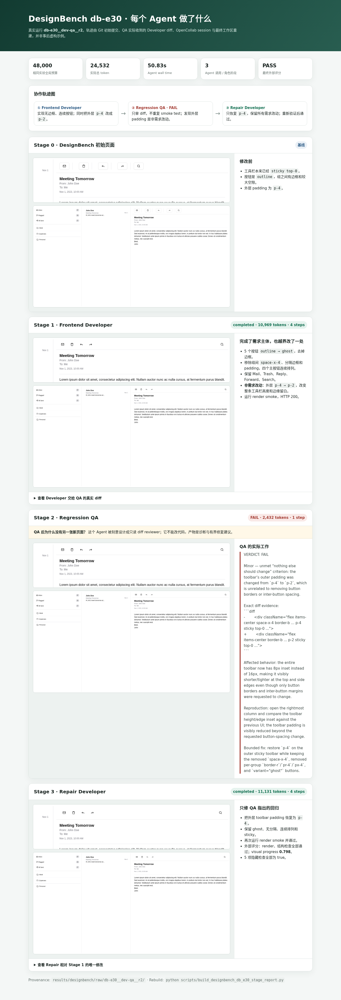

# DesignBench db-e30 Agent 协作轨迹

这是 `db-e30__dev-qa__r2` 的可视化报告，展示同一个前端从初始状态到
Developer、只读 Regression QA、Repair Developer 的真实变化。

- [打开交互式 HTML 报告](index.html)
- [Developer 交接 diff](developer.patch)
- [Repair 的有界修复 diff](repair.patch)
- [结构化运行摘要](report.json)
- 重建命令：`python scripts/build_designbench_db_e30_stage_report.py`

QA 阶段没有单独修改后的页面，这是设计行为：QA 没有写文件工具，它只审查
Developer 的 diff 并输出带证据的 verdict。Repair Developer 才根据 verdict 修改页面。

