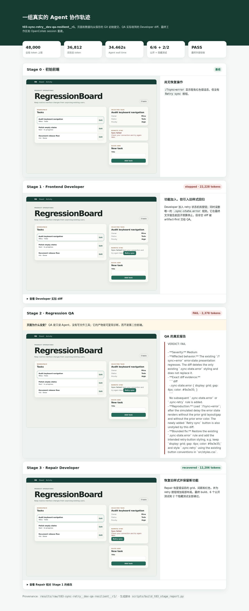

# T03 Agent stage demo

This report reconstructs one real `Developer → Regression QA → Repair` run from
versioned evidence. It is not a hand-authored mockup.



Open [`index.html`](index.html) locally for the readable interactive report with
expandable Developer and Repair diffs. Its evidence comes from:

- the run workspace's initial Git commit;
- the exact `Current diff` passed to the saved QA session;
- the final run workspace;
- `results/raw/t03-sync-retry__dev-qa-resilient__r1/agent.json` and
  `evaluation.json`.

Rebuild all screenshots and data with:

```bash
conda activate node22
python scripts/build_t03_stage_report.py
```

The four stages are:

1. initial error UI without a retry action;
2. Developer adds retry behavior but accidentally deletes the old error-state
   CSS;
3. read-only Regression QA leaves the UI unchanged and reports the exact
   regression;
4. Repair Developer restores the old styling while retaining the new behavior.
